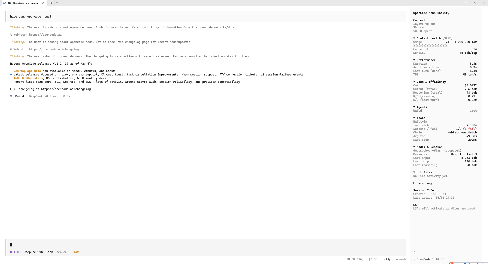

# OpenCode Enhanced Sidebar

[English](README.md) · [中文](README.zh.md) · [日本語](README.ja.md)

---

为 [OpenCode](https://github.com/anomalyco/opencode) **V2** 打造的增强侧边栏插件，提供实时会话分析、工具追踪和上下文健康监控。



## 📋 目录

- [功能](#-功能)
- [架构](#-架构)
- [安装](#-安装)
- [环境要求](#-环境要求)
- [已知限制](#-已知限制)
- [许可证](#-许可证)

## 📊 功能

### 📊 7 张折叠卡片

| 卡片 | 说明 |
|------|------|
| **Context Health** `[SAFE]/[RISK]/[HIGH]` | 上下文使用率条、缓存命中率、幻觉风险指数、对话密度 |
| **Performance** | 会话总时长、每轮均耗时、实时计时、TPS（每秒 Token） |
| **Cost & Efficiency** | 总花费、累积 Output/Reasoning Token、会话/末轮推理效率比 |
| **Agents** | 主智能体分布（如 Build / Plan 占比） |
| **Tools** | 内置工具 vs MCP 工具分类调用次数、成功率、动作链、平均工具耗时 |
| **Model & Session** | 当前模型、上下文上限、消息分布、每轮上下文组成 |
| **Hot Files** | 最常读取和修改的文件列表（含完整路径和次数） |

### ⏱️ Live 实时计时

每秒刷新，显示当前 AI 轮次已运行时长。轮次完成时自动停止。

### 🔧 工具追踪（已内置到侧边栏）

- 按会话隔离的工具调用统计（不同对话互不污染）
- MCP 工具按服务器自动分组，隐藏公共前缀
- 文件读写活动追踪，供 Hot Files 展示
- 成功率/失败率和每种工具的平均耗时
- 全部统计直接来自会话消息本身——不再需要配套的 Server 插件，也不再轮询 JSON 文件

## 架构

OpenCode V2 的助手消息内联携带工具调用状态（`content[].state`、`content[].time`），因此侧边栏只需一个终端插件：

```
你 → CLI 插件 (plugins/enhanced-sidebar/tui.tsx)
  ├─ data.session.message.list()   → 实时消息窗口（响应式）
  ├─ client.message.list()         → 完整会话消息，分页拉取（每轮结束刷新）
  ├─ client.session.diff()         → 文件变更（+/-）
  ├─ data.session.get()            → 会话花费、Token、时间
  └─ data.location.{model,mcp}     → 上下文上限、MCP 服务器名
```

## 安装

### Windows（一键）

```powershell
powershell -ExecutionPolicy Bypass -File install.ps1
```

安装脚本会把 `plugins/enhanced-sidebar/` 复制到 `~\.config\opencode\plugins\enhanced-sidebar\`，停用遗留的 V1 插件文件，并清理配置中失效的 `./rounds-plugin.tsx`、`./tool-tracker.tsx` 条目。

### 手动安装

1. 将 `plugins/enhanced-sidebar/` 目录复制到 `~\.config\opencode\plugins\enhanced-sidebar\`（Windows）或 `~/.config/opencode/plugins/enhanced-sidebar/`（macOS/Linux）。
2. 重启 OpenCode。V2 会自动发现 `plugins/enhanced-sidebar/tui.tsx`，无需修改 `opencode.jsonc` 或 `cli.json`。
   - 如需显式引用（例如按项目安装）：在 `opencode.jsonc` 中加入 `"plugins": ["./plugins/enhanced-sidebar"]`。

## 环境要求

- OpenCode ≥ v2.0（V2 插件 API）
- 无需 npm 安装依赖：OpenCode 会在运行时解析 `@opencode/plugin/tui`、`solid-js`、`@opentui/solid`。

## 已知限制

- 不支持 OpenCode V1。旧的 V1 实现（`src/rounds-plugin.tsx`、`src/tool-tracker.tsx`）仍保留在 git 历史中。
- 会话级统计通过分页消息 API 拉取完整会话记录；长会话在每轮结束后刷新一次。
- CLI 插件 API 仍不支持滚动到指定消息或切换会话。
- macOS/Linux：仅支持手动安装（安装脚本仅 Windows）。

## 开发

```sh
npm install
npm run typecheck   # 针对 OpenCode V2 插件 API 做 TypeScript 检查
npm run smoke       # 无头渲染测试（需要 Bun：https://bun.sh）
```

## 许可证

MIT © [nt-cubic](https://github.com/nt-cubic)
